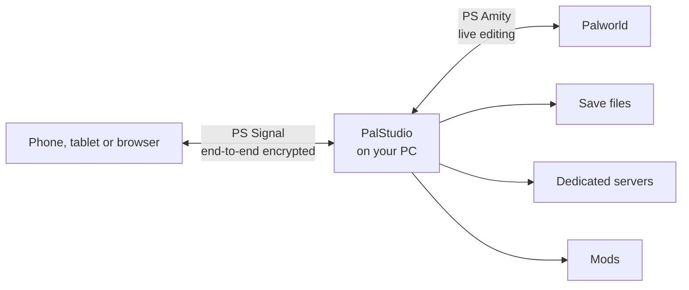

<div align="center">


# PalStudio

**Save editor, live game editing, remote access, and mod and server management for Palworld.**

_Formerly known as Palworld Save Pal._

[](https://github.com/oMaN-Rod/palstudio/releases/latest)
[](https://github.com/oMaN-Rod/palstudio/releases)
[](LICENSE)
[](https://www.nexusmods.com/palworld/mods/1827)
[](https://discord.gg/YWZFPy9G8J)

[Website](https://palstudio.app) · [Download](#download) · [Guides](https://palstudio.app/docs/guides) · [Features](#features) · [Developer guide](#developer-guide)

</div>

> [!WARNING]
> Back up your save files before using PalStudio.

## Why PalStudio?

- **Edit anything in a save:** Pals, players, guilds, bases, inventories, technology and missions, on Steam or Game Pass, solo, co-op or dedicated.
- **Edit while you play:** PS Amity connects a running game to PalStudio, so changes apply live.
- **Work from another device:** PS Signal pairs a phone, tablet or browser with your PC over an end-to-end encrypted link.
- **Run your setup:** manage mods, profiles and dedicated servers from one app.



> [!NOTE]
> PalStudio was called **Palworld Save Pal (PSP)** until v1.5.0. It's the same project under a new name, and your settings, presets and blueprints carry over. Old links to `oMaN-Rod/palworld-save-pal` redirect here.

## Download

| Platform | GitHub | Nexus Mods |
| --- | --- | --- |
| Windows | [`.msi` installer or portable `.zip`](https://github.com/oMaN-Rod/palstudio/releases/latest), both with PS Amity | [Installer or portable](https://www.nexusmods.com/palworld/mods/1827?tab=files), with PS Amity as a separate file |
| macOS | [`.dmg`](https://github.com/oMaN-Rod/palstudio/releases/latest) | [Files tab](https://www.nexusmods.com/palworld/mods/1827?tab=files) |
| Linux | [`.AppImage` or `.deb`](https://github.com/oMaN-Rod/palstudio/releases/latest) | [Files tab](https://www.nexusmods.com/palworld/mods/1827?tab=files) |
| Browser | [palstudio.app](https://palstudio.app), nothing to install | |
| Docker | [Build it yourself](#docker) | |

> [!TIP]
> On GitHub, you can skip the `-no-amity` files and the `PSAmity-UE4SS` zip. They're the same builds split up for Nexus Mods.

To get started, follow the [getting started guide](https://palstudio.app/docs/guides/getting-started). There are also guides for [save management](https://palstudio.app/docs/guides/save-management), [server setup](https://palstudio.app/docs/guides/server-setup) and [remote access](https://palstudio.app/docs/guides/remote-access).

## Features

<details open>
<summary><strong>PS Amity: live editing</strong></summary>

An in-game mod that connects your game to PalStudio. Windows only.

- **Players:** level, EXP and inventory
- **Pals:** add, remove, edit, move and heal
- **Guilds:** member roles, Base Camp level, base Pals, Guild Chest and storage
- **Technology:** read-only for now
- **Multiple games:** PalStudio finds running games and lets you switch between them

See the [install guide](ps-amity/INSTALL.md).

</details>

<details open>
<summary><strong>PS Signal: remote access</strong></summary>

Pair a device by scanning a QR code, or by typing the code.

- **Live map:** follow players and Pals in real time, or pop the map out as a picture-in-picture minimap
- **Remote editing:** browse and edit the Steam, Game Pass and server saves on your PC
- **Server control:** start, stop, configure and watch the console
- **Live edits:** change a running game from anywhere when paired with PS Amity

Nothing can connect while remote access is off, and you can revoke any device at any time. See the [remote access guide](https://palstudio.app/docs/guides/remote-access).

</details>

<details>
<summary><strong>Mod manager</strong></summary>

- Keep a mod library with profiles, load order and world links
- Share a setup with a `.psmods` file
- Install and update UE4SS and PalSchema
- See conflicts between mods, and convert paks for Game Pass
- Verify which mods loaded, through PS Amity

</details>

<details>
<summary><strong>Pals</strong></summary>

- Edit Palbox, Base, Dimensional Pal Storage and Global Pal Storage Pals
- Edit nickname, gender, level, rank, souls, trust and work suitability
- Edit active, learned and passive skills
- Set or unset Lucky and Boss
- Add, remove and clone Pals
- Heal Pals by editing health and stomach (modified Pals are healed automatically)
- Filter and sort by name, nickname, character ID, Boss, Lucky, Human, level, Paldeck number, Predator, Oil Rig, Summon or element
- Create active and passive skill presets
- Apply a Pal preset to many Pals at once, for example to max out all Dragon types

</details>

<details>
<summary><strong>Players</strong></summary>

- Edit name, level and stats (health, stamina, attack, work speed and weight)
- Heal players by editing health and stomach
- Edit inventory, and create loadouts to apply across players and saves
- Edit the technology tree, technology points and Ancient Technology points
- Edit active and completed missions
- Rank players and scan DPS for legality
- Delete players, along with their map objects, items and Pals

</details>

<details>
<summary><strong>Guilds</strong></summary>

- Edit guild name, Guild Chest, base Pals, base inventory and lab research
- Edit base name (shows only in PalStudio for now, not in game)
- Delete guilds, along with their players, map objects, items and Pals

</details>

<details>
<summary><strong>World map</strong></summary>

- See players, bases, fast travel points, dungeons, effigies, and alpha and predator Pals
- Toggle individual fast travel points, or unlock them all for a player
- Toggle individual effigies, or collect them all for a player
- Remove the map fog

</details>

<details>
<summary><strong>Tools</strong></summary>

- **Save conversion:** convert between Steam and Game Pass, for the loaded save or standalone saves
- **Game Pass browser:** view, inspect, rename and delete Game Pass saves
- **Steam ID converter:** turn a Steam ID or profile URL into a Palworld UID and NoSteam UID
- **Player UID swap:** swap UIDs between two players, for example when moving from co-op to a dedicated server
- **Player transfer:** move a player between saves, choosing which data goes with them
- **Raw editor:** edit a `.sav` file directly as JSON
- **Blueprints:** import bases from PST exports and `.psbp` files

</details>

<details>
<summary><strong>Dedicated servers</strong></summary>

- Manage servers natively on Windows, or with Docker on Windows, Linux and macOS
- Create and install servers, with SteamCMD detection and download, and port suggestions
- Update native servers through SteamCMD
- Start and stop servers, watch the live console, and monitor player counts
- Edit `PalWorldSettings.ini`, including RCON and REST API settings
- Install, list and toggle Steam Workshop mods, including the official `PalModSettings.ini` system on native servers
- Open a server's save directly in the editor

</details>

<details>
<summary><strong>And more</strong></summary>

- **Universal Pal Storage:** organize Pals into tagged collections and move them across any player and save
- **Presets:** manage player, Pal, skill and storage presets
- **Data Explorer:** browse Pals, items, skills, buildings and technologies
- **Guides and wiki:** built into the app
- **Themes:** Dark, Light and Frontier (thanks to @CyrixJD115)
- **Languages:** Deutsch, English, Español, Español (México), Français, Italiano, Bahasa Indonesia, 한국어, Polski, Português, Русский, ไทย, Türkçe, Tiếng Việt, 简体中文 and 繁體中文

</details>

## Docker

1. Clone the repository:

   ```bash
   git clone https://github.com/oMaN-Rod/palstudio.git
   cd palstudio
   ```

2. Run the build script for your system. It detects your IP address and passes it to the web app:

   ```bash
   # Linux
   ./scripts/build-docker.sh
   ```

   ```powershell
   # Windows
   .\scripts\build-docker.ps1
   ```

<details>
<summary>Set it up by hand instead</summary>

Set `PUBLIC_WS_URL` in `docker-compose.yml` to the host and port browsers will use:

```yaml
services:
  backend:
    build:
      context: .
      dockerfile: Dockerfile
      args:
        # Change this to the host:port browsers will use to reach the server
        - PUBLIC_WS_URL=127.0.0.1:5174/ws
    ports:
      - "5174:5174"
    volumes:
      - ./data:/app/data
      # Persists ps-rs.db (settings, presets, UPS).
      - ./db:/app/db
```

Then build and start the container:

```bash
docker compose up --build -d
```

</details>

## Developer guide

PalStudio ships mainly as a desktop app for Windows, macOS and Linux, and also runs on the web and in Docker. The backend is a Rust workspace at the repo root.

| Guide | What it covers |
| --- | --- |
| [Rust developer guide](docs/rust-dev-guide.md) | The workspace and how to work in it |
| [Plugin guide](docs/plugins.md) | Where plugin authors should start |
| [Plugin API reference](docs/plugin-api.md) | Exact schemas and runtime behavior |
| [PS Amity](ps-amity/README.md) | The in-game mod |

### Web

`dev:web` starts the Vite dev server and the Rust backend together:

```bash
cd ps-ui
bun install
bun run dev:web
```

Then open <http://127.0.0.1:5173>.

### Desktop app

Run the app with hot reload. Tauri starts the Vite dev server for you, and needs the Tauri CLI (`cargo install tauri-cli --version "^2" --locked`):

```bash
cd ps-ui && bun install && cd ..
cd ps-desktop
cargo tauri dev
```

### Build the desktop app

The build script builds the UI, runs `cargo tauri build`, and collects the artifacts into `dist/`:

```powershell
# Windows: MSI installer and portable zip
.\scripts\build-desktop.ps1
```

```bash
# macOS (.dmg) and Linux (.deb)
./scripts/build-desktop.sh
```

### PS Amity

On Windows, with the game closed:

```powershell
.\ps-amity\scripts\setup-workspace.ps1   # once: clones the pinned UE4SS fork
.\dev.ps1 -Amity                         # builds the mod and installs it into Palworld
```

`dev.ps1 -Amity -Check` reports what's missing, and `-GameDir` overrides the Steam auto-detection.

> [!IMPORTANT]
> JSON exported by the old Python tooling (palworld-save-tools `convert.py`) can't be converted back to `.sav` through `POST /api/convert/json-to-sav` or the Raw editor. Re-export the save with this version first.

## License

[GNU General Public License v3.0](LICENSE). You're free to use, modify and redistribute this software, as long as derivative works use the same license and make their source available.

The GPL covers PalStudio's own source. It doesn't extend to the Palworld game data and derived assets in this repository, which remain the property of their owners. See [THIRD_PARTY_NOTICES.md](THIRD_PARTY_NOTICES.md).

> [!NOTE]
> PalStudio is a fan-made tool. It isn't affiliated with, endorsed by or sponsored by Pocketpair, Inc. Palworld is a trademark of Pocketpair, Inc. All game names, artwork, models and data belong to their respective owners, and appear here only so the tool can read and display your own save file.

## Support the project

[](https://buymeacoffee.com/i_am_o)
